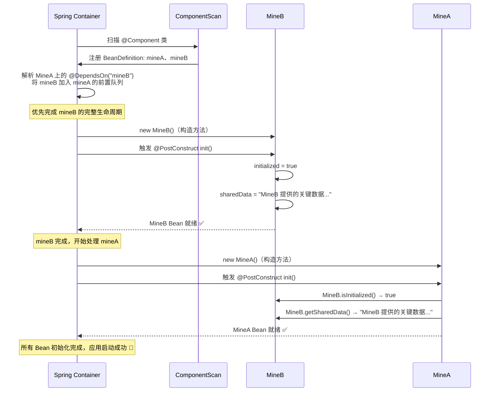
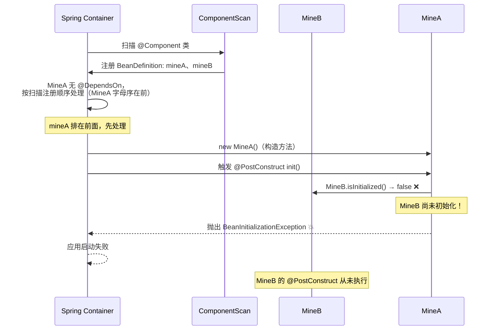
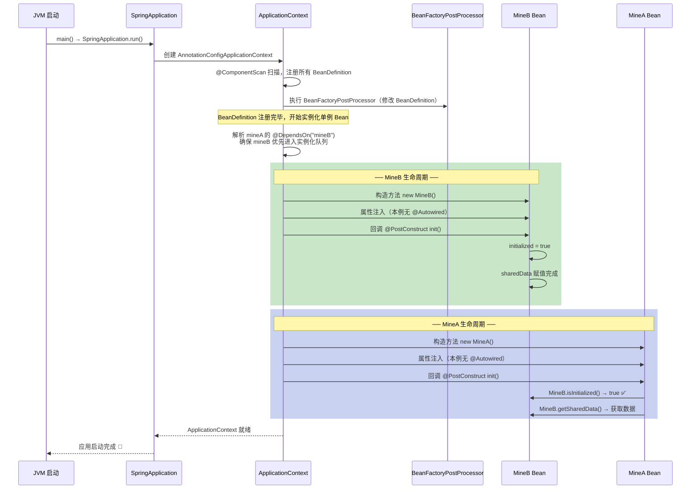

# @DependsOn —— Bean 初始化顺序控制

## 一、问题背景

Spring 容器默认按**依赖关系图**决定 Bean 的创建顺序：A `@Autowired` B，Spring 就知道先创建 B。  
但当两个 Bean 之间存在**隐式依赖**（Spring 依赖图中看不见的关系）时，顺序就无法保证，轻则数据为 null，重则启动直接崩溃。

### 典型隐式依赖场景

| 场景 | 说明 |
|------|------|
| 静态字段 / 静态方法 | A 调用 `B.getStaticData()`，Spring 不知道这条依赖 |
| 第三方注册中心 | B 向某个全局 Registry 注册自己，A 从 Registry 读取 |
| 原生资源初始化 | B 初始化 JNI / 文件句柄 / 连接池，A 直接使用 |
| 多模块 `@Configuration` | 两个配置类分别定义 A 和 B，加载顺序不可控 |

本工程示例属于第一种：`MineA` 通过 `MineB.isInitialized()` 静态方法读取状态，Spring 的依赖图中看不见这条关系。

---

## 二、本工程示例结构（@Component 方式）

```
com.deepblue.dependsOn
├── MineB.java   ← @Component("mineB")，必须先初始化（向静态字段写数据）
└── MineA.java   ← @Component("mineA") + @DependsOn("mineB")，必须后初始化
```

### MineB — 先行者

```java
@Slf4j
@Component("mineB")          // ← 注册为 Spring Bean
public class MineB {

    private static volatile boolean initialized = false;
    private static volatile String sharedData;

    @PostConstruct
    public void init() {
        sharedData = "MineB 提供的关键数据 [time=" + LocalDateTime.now() + "]";
        initialized = true;                  // ← 标记自己已就绪
        log.info(">>> MineB @PostConstruct 完成: {}", sharedData);
    }

    public static boolean isInitialized() { return initialized; }
    public static String getSharedData()  { return sharedData;  }
}
```

### MineA — 后继者

```java
@Slf4j
@Component("mineA")          // ← 注册为 Spring Bean
@DependsOn("mineB")          // ← 核心：去掉此注解，启动必报 BeanInitializationException
public class MineA {

    @PostConstruct
    public void init() {
        log.info(">>> MineA @PostConstruct 开始...");

        if (!MineB.isInitialized()) {        // ← 隐式依赖检查
            throw new BeanInitializationException(
                "MineA 初始化失败！MineB 必须先完成初始化。\n" +
                "请在 MineA 类上添加 @DependsOn(\"mineB\")"
            );
        }

        String data = MineB.getSharedData();
        log.info(">>> MineA @PostConstruct 成功，获取到 MineB 的数据: {}", data);
    }
}
```

> `MineA` 没有 `@Autowired MineB`，Spring 完全看不见这条依赖，
> 必须用 `@DependsOn` 手动声明。

---

## 三、执行顺序时序图

### 正确顺序 —— 有 @DependsOn("mineB")



---

### 错误顺序 —— 无 @DependsOn（注释掉 MineA 上的 @DependsOn 后重启）



---

### 加载阶段完整时序（Bean 生命周期视角）



---

## 四、@Component 方式 vs @Bean 方式

两种方式的 `@DependsOn` 标注位置不同，效果完全一致。

### @Component 方式（当前工程）

`@DependsOn` 直接标注在**类**上：

```java
@Component("mineA")
@DependsOn("mineB")          // ← 标注在类上
public class MineA { ... }

@Component("mineB")
public class MineB { ... }
```

**无 @DependsOn 时的失败原因**：`@ComponentScan` 按文件系统扫描顺序注册 BeanDefinition，
`MineA`（字母序 A < B）通常先于 `MineB` 被扫描注册，导致实例化时 MineB 尚未就绪。

---

### @Bean 方式（@Configuration 配置类）

`@DependsOn` 标注在**@Bean 方法**上：

```java
@Configuration
public class OrderConfig {

    @Bean("mineA")
    @DependsOn("mineB")      // ← 标注在 @Bean 方法上
    public MineA mineA() { return new MineA(); }

    @Bean("mineB")           // ← 方法定义在 mineA 之后（故意制造顺序问题）
    public MineB mineB() { return new MineB(); }
}
```

**无 @DependsOn 时的失败原因**：`@Bean` 方法按**配置类中的代码定义顺序**执行，
`mineA()` 写在前面，Spring 先创建 MineA，MineB 尚未初始化 → 报错。

---

### 两种方式对比

| 维度 | @Component 方式 | @Bean 方式 |
|------|----------------|-----------|
| @DependsOn 标注位置 | 类上 | @Bean 方法上 |
| 无 @DependsOn 时的失败触发 | ComponentScan 扫描字母序 | @Bean 方法代码定义顺序 |
| 适用场景 | 自己编写的类，直接加注解 | 第三方类 / 需要手动 new 的对象 |
| 与 @Component 同时使用 `@Configuration` | 会触发**同名 Bean 重复注册异常** | 正常 |

> **重要**：`@Component` 和 `@Bean` 不能同时注册同一个 Bean 名（如都叫 `"mineA"`），
> Spring Boot 2.1+ 默认禁止 Bean 覆盖，会抛出 `BeanDefinitionOverrideException`。
> 两种方式**二选一**，本工程使用 `@Component` 方式。

---

## 五、@DependsOn 的多 Bean 写法

```java
// 依赖多个 Bean：数组形式
@Component("mineA")
@DependsOn({"mineB", "mineC", "dataSourceInitializer"})
public class MineA { ... }
```

---

## 六、@DependsOn vs @Autowired 的本质区别

| 维度 | @Autowired | @DependsOn |
|------|-----------|------------|
| 作用 | 注入 Bean 引用（同时隐含顺序保证） | **仅**保证初始化顺序，不注入引用 |
| Spring 是否感知依赖 | 是，自动推断 | 否，需手动声明 |
| 适用场景 | A 需要持有 B 的引用 | A 需要 B 的**副作用**（静态状态、全局注册、资源准备等） |
| 不声明时的后果 | 编译期/运行期注入失败 | 顺序不确定，可能偶发性报错（最难排查） |

> **结论**：有 `@Autowired` 时，`@DependsOn` 通常是多余的；  
> 没有 `@Autowired` 但存在隐式依赖时，`@DependsOn` 是**唯一可靠手段**。

---

## 七、注意事项

### 1. @DependsOn 只保证"初始化完成"，不保证"销毁顺序"
销毁（`@PreDestroy`）顺序与初始化**相反**：MineA 先销毁，MineB 后销毁。这是 Spring 的默认行为，无需额外配置。

### 2. 不要形成循环依赖
```java
// 错误：A 依赖 B，B 又依赖 A → 启动直接报错
@DependsOn("mineA") class MineB { ... }
@DependsOn("mineB") class MineA { ... }
// 抛出: BeanCreationException: Circular depends-on relationship
```

### 3. Bean 名称必须拼写正确
`@DependsOn` 接收的是字符串，拼错不会有编译报错，运行时才会抛出 `NoSuchBeanDefinitionException`。  
建议配合常量使用：
```java
public interface BeanNames {
    String MINE_B = "mineB";
}

@DependsOn(BeanNames.MINE_B)
public class MineA { ... }
```

### 4. 与 @Lazy 同时使用时需小心
`@Lazy` Bean 默认不在启动时初始化。若 MineA `@DependsOn` 一个 `@Lazy` 的 MineB，
Spring 会**强制**提前初始化 MineB（打破 Lazy 效果）。这是预期行为，但需知晓。

### 5. @DependsOn 不能替代 @Order
`@Order` 控制的是**集合注入时的顺序**（如 `List<Filter>` 的排列），  
`@DependsOn` 控制的是 **Bean 生命周期的初始化顺序**，两者解决不同问题。

### 6. 优先考虑消除隐式依赖
`@DependsOn` 是补救手段，最佳实践是**显式声明依赖**：
```java
// 推荐：通过构造参数让 Spring 自动推断顺序（@Component 方式用构造注入）
@Component("mineA")
public class MineA {
    private final MineB mineB;

    public MineA(MineB mineB) {   // Spring 看见了这条依赖，自动保证顺序
        this.mineB = mineB;
    }
}
```
只有当无法通过注入表达依赖关系时（静态调用、第三方框架、资源初始化），才使用 `@DependsOn`。

---

## 八、实验步骤

1. 启动项目，观察日志顺序（正确顺序）：
   ```
   >>> MineB @PostConstruct 完成: MineB 提供的关键数据 [time=...]
   >>> MineA @PostConstruct 成功，获取到 MineB 的数据: ...
   ```

2. 注释掉 `MineA.java` 类上的 `@DependsOn("mineB")`，重启。

3. 观察启动失败日志（错误顺序）：
   ```
   >>> MineA @PostConstruct 开始...
   ERROR o.s.boot.SpringApplication - Application run failed
   BeanInitializationException: MineA 初始化失败！MineB 必须先完成初始化。
   ```

4. 恢复 `@DependsOn("mineB")`，重启，确认恢复正常。
